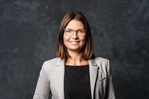
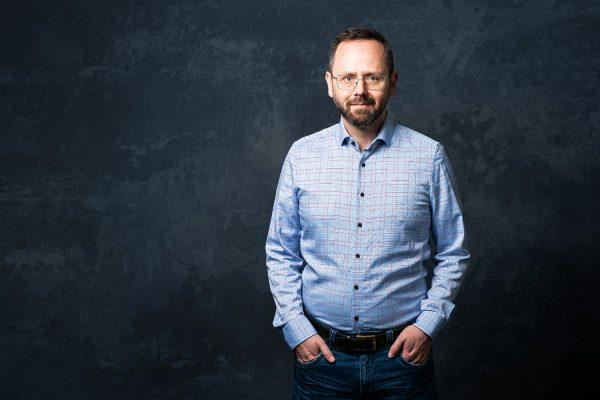

Du möchtest ein eigenes Unternehmen in Nordthüringen gründen und bist dir nicht sicher, wie du deine Idee umsetzen kannst? Es fehlt vielleicht an unternehmerischem Know-how und du benötigst Unterstützung bei der Erstellung deiner Business- und Finanzplanung?

Dann bist du hier richtig! Die Gründungs- und Finanzierungsbegleiter von [ThEx Enterprise](https://www.thex.de/) unterstützen Existenzgründungen und junge Unternehmen bei der Umsetzung von Geschäftsideen. Dazu gehören:

- Gründungen Schritt für Schritt begleiten, unter anderem durch die Unterstützung bei der Erstellung einer Business- und Finanzplanung
- Wissensvermittlung in Seminaren und Workshops
- Vernetzung in allen Regionen Thüringens

Wir laden Gründungsinteressierte von 09:00 – 13:00 Uhr zu einem Sprechtag rund um das Thema Existenzgründung ein. Ziel der Beratungsgespräche ist, über aktuelle öffentliche Förderprogramme zu informieren, konkrete Problemfälle von Unternehmen zu besprechen und das Bewusstsein für Sicherheitsfragen bei der Finanzierung von Existenzgründungen, Existenzfestigungen und Betriebsübernahmen zu wecken. Am konkreten Gründungs- bzw. Investitionsvorhaben können die Fördermöglichkeiten aufgezeigt und Finanzierungshemmnisse ausgeräumt werden.

## Termin vereinbaren

Die individuelle Terminabstimmung erfolgt über die ThEx-Enterprise-Gründungsbegleiterin Christiane Nöthling, unter der Mobilnummer [036202 26255](tel:+493620226255) oder per E-Mail an [cnoethling@parisat.de](mailto:cnoethling@parisat.de).

## Das Beratungsteam

**Christiane Nöthling** – Gründungsbegleiterin Nordthüringen

**Oliver Krahl** – Bankkaufmann, Dipl.-Betriebswirt (FH), jahrelange Erfahrung in der Gründungsberatung und Unternehmensfinanzierung, u. a. auch Aufbau der Mikrofinanzagentur Thüringen
